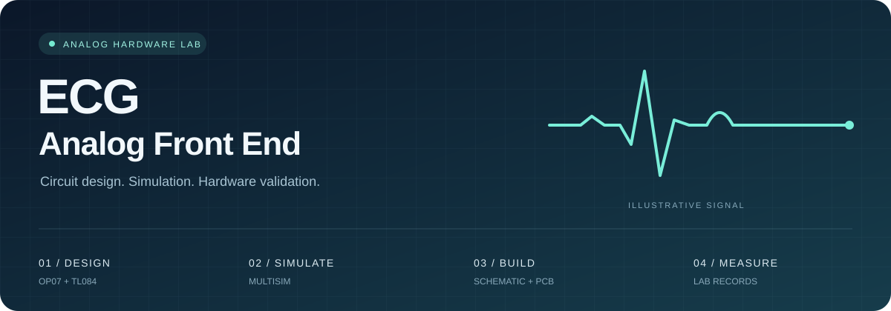
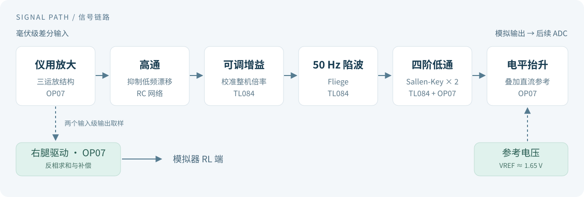
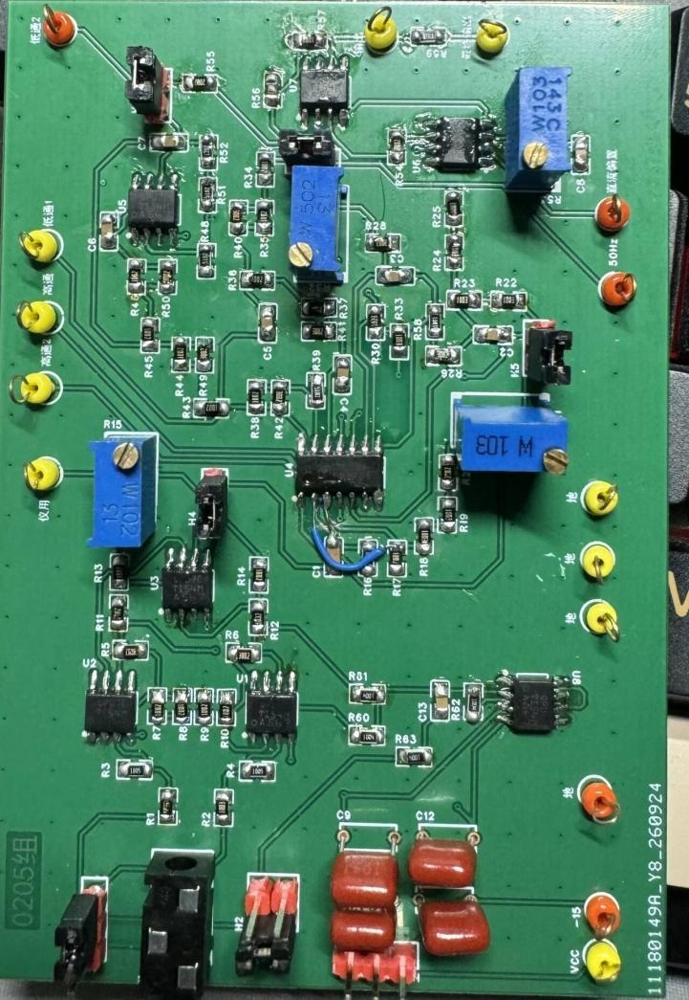

<p align="center">
  
</p>

<h1 align="center">心电信号模拟前端：从电路设计到实物验证</h1>
<p align="center"><b>ECG Analog Front End: From Circuit Design to Hardware Validation</b></p>
<p align="center">OP07 · TL084 · Multisim · PCB · 模拟电路课程实践</p>

<p align="center">
  <a href="#项目概览">项目概览</a> ·
  <a href="#信号链路">信号链路</a> ·
  <a href="#实物与测试">实物与测试</a> ·
  <a href="#文件导航">文件导航</a> ·
  <a href="#如何复现">如何复现</a>
</p>

---

## 项目概览

这是一个基于 **OP07 与 TL084** 的心电信号模拟前端课程项目：将毫伏级差分信号进行放大、滤波和电平抬升，为后续 ADC 采样提供模拟输入。

项目记录了参数计算、Multisim 仿真、原理图与 PCB 设计、焊接以及实物调试过程。它不仅包含电路工程，也保留了元件选型、精密电阻组合、参数校准和硬件修改的实验记录。

| 放大 | 滤波 | 输出接口 | 工程资料 |
| :--- | :--- | :--- | :--- |
| 整机目标 **1500 V/V** | **50 Hz** 陷波与四阶低通 | 直流中心约 **1.65 V** | 仿真、EDA 工程、实验报告 |

> 本项目是教学实验电路，只连接实验室信号源或心电模拟器，不连接人体。仓库范围为模拟前端，不包含 ADC 采集程序或心电诊断算法。

## 信号链路

<p align="center">
  
</p>

| 模块 | 实现方式 | 设计考虑 |
| :--- | :--- | :--- |
| 仪用放大器 | 三运放结构，OP07，标称增益约 25 | 放大差分信号；输入两路及差分级电阻的比值匹配影响共模抑制 |
| 高通与可调增益 | RC 高通接 TL084 非反相增益级 | 先抑制直流与低频漂移，再进行较大倍率放大；增益可校准 |
| 50 Hz 陷波 | 两运放 Fliege 结构 | 在工频附近形成陷波，通过微调电阻调整中心频率 |
| 四阶低通 | 两节非反相 Sallen-Key 级联 | Q 值接近四阶 Butterworth 配置；低 Q 节在前，高 Q 节在后 |
| 电平抬升 | 参考电压与交流信号相加 | 将输出直流中心调至约 1.65 V，适配后续单极性采样范围 |
| 右腿驱动支路 | 取样仪放两个输入级的输出，反相求和 | 用于模拟器条件下的共模反馈实验；不是主信号串联级 |

### 几个关键设计取舍

- **增益分配，而非一级放大到底。** 仪放先提供适度增益，高通之后再补足放大量，减轻直流偏置引起后级饱和的风险。
- **精密电阻用在匹配和比值敏感处。** 既考虑标称精度，也考虑成对匹配；库存阻值不足时使用串并联组合，并复核等效值。
- **区分单节自然频率与整机截止频率。** 两节低通与陷波器级联后，需要检查整条信号通路的频率响应。
- **将仿真作为调试起点。** 实物中的供电、引脚、元件误差、测量设置和实际接线仍需要逐项核对。

<details>
<summary><b>展开查看：报告设计章节中的参数示例</b></summary>

以下是报告中的计算基准，不代表所有历史工程文件已经同步为同一版本。

| 项目 | 参数或关系 |
| :--- | :--- |
| 仪放标称增益 | `1 + (30 kΩ + 30 kΩ) / 2.50 kΩ = 25` |
| 一阶高通 | `820 nF` 与 `2.20 MΩ`，理论截止频率约 `0.0882 Hz` |
| 可调增益级 | 增益电位器约 `2.80 kΩ` 时，标称增益约 `23.58` |
| 低通频率电阻 | `10 kΩ + (10 kΩ ∥ 30 kΩ) = 17.5 kΩ`；每节电容均为 `100 nF` |
| 两节低通 | `K1 = 1.15，Q1 ≈ 0.5405`；`K2 = 2.24，Q2 ≈ 1.3158` |
| 输出电平 | `VADC = VAC + VREF`，`VREF ≈ 1.65 V` |

整机增益应使用指定测试频率下的端子输入与末级输出幅值比校准，不能仅把各级标称增益相乘。

</details>

## 实物与测试

<p align="center">
  
  <br>
  <sub>已焊接 PCB 实物，图片提取自实验报告；保留实际装配与调试状态。</sub>
</p>

下面摘录的是**实验报告中的实物测试记录**，不是理想计算或本次重新测量的结果。

| 项目 | 报告记录 | 条件与说明 |
| :--- | :--- | :--- |
| 供电 | 正电源约 `+11.9 V`，负电源约 `−12.0 V` | 实物测试采用约 ±12 V 供电 |
| 整机差模增益 | 约 **1525 V/V** | 约 10 Hz；输入设定 2 mVpp，输出游标读数 3.050 Vpp |
| 近似 −3 dB 频率范围 | 约 **0.1–93 Hz** | 按报告所测通路与通带参考幅值估计；50 Hz 附近另有陷波 |
| 输出直流中心 | 约 **1.65 V** | 电平抬升后的最终输出 |
| 约 50 Hz 的模块衰减 | 约 **26.5 dB** | 按报告记录的 2 Vpp 输入、94.7 mVpp 输出计算；不是整机增益 |
| 运放与调节资源 | **11 个运放单元、4 只电位器** | 7 个 OP07 单元与一片 TL084 的 4 个单元 |

完整波形、测试方法及其他指标见[实验报告](0205组第一阶段实验报告.pdf)。输入阻抗、共模抑制和噪声应结合各自的测试连接与带宽条件阅读，不由上表推断。

### 实际调试记录

报告记录了供电引脚检查、输入端连接修正、重新制板、局部飞线和库存电阻替代。这些问题说明：原理图核查、断电通断检查和逐级测试，与参数计算同样重要。

右腿驱动接入前后，在本次模拟器测试中**未观察到明显的波形变化**。因此，这里不将其列为已经证实的抗干扰性能提升。

## 文件导航

| 文件 | 用途 | 建议打开方式 |
| :--- | :--- | :--- |
| [实验报告](0205组第一阶段实验报告.pdf) | 设计计算、仿真结果、实物测试和调试总结 | PDF 阅读器 |
| [可行性设计笔记](ECG_AFE_可行性设计.md) | 设计推导、器件选择与历史方案记录 | GitHub 或 Markdown 阅读器 |
| [Multisim 工程](Design1.ms14) | 查看与运行电路仿真 | 兼容该文件版本的 Multisim |
| [EDA 工程](电子实验心电测量.eprj2) | 查看原理图与 PCB | 支持 `.eprj2` 的 EDA 软件 |
| [仿真安全副本](Design1.ms14%20%28Security%20copy%29) | 保留已有仿真备份 | 使用前复制并另存，不覆盖原件 |
| [配图目录](docs/assets/) | 首页封面、信号链路图和 PCB 照片 | 浏览器或图片查看器 |
| [协作约定](AGENTS.md) | 文件组织、验证与变更要求 | 文本编辑器 |

## 如何复现

1. **先读报告，再读设计笔记。** 了解测试条件和迭代经过；不要把早期计算参数直接视为实物最终参数。
2. **打开原生工程。** 使用 Multisim 查看仿真，使用兼容的 EDA 软件查看原理图与 PCB；GitHub 网页不能直接运行这些工程。
3. **核对版本与关键连接。** 检查供电、运放引脚、RC 参数和报告中的飞线修改是否已经同步到所用工程。
4. **逐级检查，再测整机。** 先核对静态工作点，再测试增益、滤波及电平抬升；记录测点、输入幅度、频率和电位器设置。

Windows 已配置文件关联时，可在仓库根目录运行：

```powershell
Start-Process '.\Design1.ms14'
Start-Process '.\电子实验心电测量.eprj2'
```

当前仓库没有自动化构建或测试脚本。设计笔记曾引用的 `ecg_afe_verify.py` 未包含在当前文件中，不能按该引用直接执行验证。

## 版本说明与后续工作

本仓库保留了不同阶段的设计与测试资料。例如，早期设计讨论包含 ±15 V 供电，实物报告记录约 ±12 V；高通参数也经过调整。复现时应明确采用的版本，不能将不同版本的计算、仿真和实测结果拼接为同一次验证。

- [ ] 将实物修正完整回标到原理图、PCB 与元件清单，并标记修订版本。
- [ ] 补充可直接浏览的最终原理图及 PCB 导出图。
- [ ] 整理统一测点和仪器设置下的复测数据。
- [ ] 在可控共模干扰条件下，进一步比较右腿驱动接入前后的表现。

欢迎围绕电路复核、测量方法和复现记录交流。提交修改时，请说明所用工程版本、改动的电路级，以及对应的验证结果。

---

<p align="center"><sub>从计算到仿真，从电路板到测试记录。</sub></p>
